# Mobile Provider Billing Assistant

SE4458 Midterm, Group 2 (AI Billing Support Assistant). A billing REST API for a fictitious mobile
provider: the provider records usage and calculates monthly bills; subscribers log in to see their
bill, its breakdown and the month so far, and pay it.
On top of it: an MCP server over the billing guide, and an AI agent (Claude Haiku) that answers a
logged-in subscriber's questions by choosing the billing API, the guide or both. Everything runs
on AWS (eu-north-1) behind an API Gateway: see [Deployment](#deployment).
Built with TypeScript, Express and PostgreSQL.

- **AI agent (chat page):** https://bi-b64790aca077475db74fde98548c2894.ecs.eu-north-1.on.aws/
- **API Gateway:** https://e57dg4znaj.execute-api.eu-north-1.amazonaws.com/api/v1 (the base URL: lists
  the version and its routes)
- **Swagger (through the gateway):** https://e57dg4znaj.execute-api.eu-north-1.amazonaws.com/api-docs/
- **MCP server:** https://bi-814046f5580045559bc8c2452688e657.ecs.eu-north-1.on.aws/mcp (for MCP
  clients, which POST to it; a browser gets a short description)
- **Source code:** https://github.com/HawkOsm/se4458-midterm-billing-assistant
- **Swagger page (local):** http://localhost:3000/api-docs/ (raw spec: `/openapi.json`)
- **OpenAPI specification file:** [docs/openapi.json](docs/openapi.json) (OpenAPI 3.0.3, written
  from the code by `npm run openapi`; a test fails if it differs from what the API serves)
- **ER diagram:** [below](#data-model-er-diagram); decisions and business rules: [docs/data-model.md](docs/data-model.md)

Run locally (Node 24 and Docker):

```
docker compose up -d        # PostgreSQL 17 on localhost
cp .env.example .env        # works as it is for a local run
npm install
npm run migrate             # creates the tables (migrations/*.sql)
npm run seed                # demo logins + usage and bills for Sep/Oct 2026
npm run dev                 # http://localhost:3000
```

Other commands: `npm test`, `npm run typecheck`, `npm run build` and `npm start` (the compiled app).
The MCP documentation server: `npm run mcp` (stdio) or `npm run mcp:http` (http://localhost:4000/mcp);
see [MCP server](#mcp-server). The AI agent's chat page: `npm run agent` (http://localhost:5000, needs
`ANTHROPIC_API_KEY` in `.env` and the other two servers running); see [AI agent](#ai-agent).

## Demo accounts

Fictitious test data created by `npm run seed`. The passwords and the key are public on purpose and
come from `.env.example`.

| Username | Password | Subscriber No |
| --- | --- | --- |
| ayse | Demo-Ayse-2025 | 5551234 |
| mehmet | Demo-Mehmet-2025 | 5559999 |

The provider's systems don't log in: they send an API key. The demo key (named `provider-demo`) is
`pk_demo-provider-key-public-do-not-deploy-7f3c2a91`.

The seed also records usage and calculates bills for the assignment's example questions
("What is my October bill?", "Why is my October bill higher?"): Ayse September 2026 **$50**
(800 min, 15 GB) and October 2026 **$80** (1,350 min, 35 GB: one extra phone block and two extra
internet blocks), Mehmet October 2026 **$70**. Running the seed again adds nothing.

## Endpoints

All routes are under `/api/v1`; `GET /api/v1` itself lists the version, the Swagger address and the
routes. Two kinds of caller. A **subscriber** logs in (`POST /login`,
then `Authorization: Bearer <token>`) and acts only on their own number (another subscriber's gets
403); the AI agent always works as the subscriber who logged in. The **provider's systems** (the
network's usage collector, the billing run) send `X-API-Key: <key>`: they record usage and can
calculate or read any subscriber's bill, but can't pay for one. Errors are always
`{ "error": "message" }`.
Every bill response has `estimate`: `true` while the month is still running, so the total is only
the amount so far and can't be paid yet.

| Operation | Route | Who | Success | Errors |
| --- | --- | --- | --- | --- |
| Log in | `POST /login` | anyone | 200 token (15 min) | 400, 401, 429 |
| Query Bill | `GET /subscribers/{no}/bills/{year}/{month}` | anyone (assignment: no auth) | 200 | 400, 404 |
| Query Bill Detailed | `GET /subscribers/{no}/bills/{year}/{month}/details?offset=0&limit=20` | own subscriber, provider key | 200 | 400, 401, 403, 404 |
| Calculate Bill | `PUT /subscribers/{no}/bills/{year}/{month}` | own subscriber, provider key | 201 created, 200 recalculated | 400, 401, 403, 404, 409, 422 |
| Add Usage | `POST /subscribers/{no}/usage` + `Idempotency-Key` header | provider key | 201 | 400, 401, 403, 404, 409 |
| Pay Bill | `POST /subscribers/{no}/bills/{year}/{month}/payments` | own subscriber | 201 | 400, 401, 403, 404, 409, 422 |

The assignment lists each operation with its parameters; here the subscriber, year and month are
part of the URL (the bill is a resource of its subscriber) and the rest is the JSON body.

A whole month, end to end (copy into a terminal while `npm run dev` runs). Run it once on a freshly
seeded database: after the payment, April 2025 is locked, so a second run gets 409s.

```
API=http://localhost:3000/api/v1
login() { curl -s -X POST $API/login -H "Content-Type: application/json" \
  -d "{\"username\":\"$1\",\"password\":\"$2\"}" | node -pe 'JSON.parse(require("fs").readFileSync(0)).accessToken'; }
PROVIDER="X-API-Key: pk_demo-provider-key-public-do-not-deploy-7f3c2a91"
AYSE="Authorization: Bearer $(login ayse Demo-Ayse-2025)"
KEY() { node -e 'console.log(crypto.randomUUID())'; }

# 1) the provider's systems record April 2025: 1,350 minutes and 35 GB (the guide's worked example)
curl -s -X POST $API/subscribers/5551234/usage -H "$PROVIDER" -H "Idempotency-Key: $(KEY)" \
  -H "Content-Type: application/json" -d '{"year":2025,"month":4,"usageType":"PHONE","quantity":135}'
for MB in 10000 10000 10000 5000; do          # 35,000 MB
  curl -s -X POST $API/subscribers/5551234/usage -H "$PROVIDER" -H "Idempotency-Key: $(KEY)" \
    -H "Content-Type: application/json" -d "{\"year\":2025,\"month\":4,\"usageType\":\"INTERNET\",\"quantity\":$MB}"
done
curl -s -X PUT $API/subscribers/5551234/bills/2025/4 -H "$PROVIDER"        # calculate: total "80.00"

# 2) the subscriber reads and pays
curl -s $API/subscribers/5551234/bills/2025/4                              # query (no login needed)
curl -s "$API/subscribers/5551234/bills/2025/4/details?limit=5" -H "$AYSE"  # breakdown + usage
curl -s -X POST $API/subscribers/5551234/bills/2025/4/payments -H "$AYSE" \
  -H "Content-Type: application/json" -d '{"transactionId":"demo-pay-1","amount":"25.00"}'
```

## Design

The folders follow the instructor's `apiNode` repository, plus `controllers/` from his
`se4458-TodoApi`. Each layer only talks to the one below it:

controller (`src/controllers`, HTTP only: validate, call the service, pick the status code) ->
DTO (`src/dto`, the JSON shapes) -> service (`src/services`, the business rules) -> DB context
(`src/db`, the only place with SQL) -> PostgreSQL. `src/domain` holds the entities, the money
helpers and the tariff (prices).

- **Database:** PostgreSQL with plain SQL through `pg`, as in the instructor's examples, always with
  `$1` parameters (no SQL injection). The schema lives in numbered files in `migrations/` that
  `npm run migrate` applies once each, so the tables can change later without being recreated.
- **Business rules in the database too:** UNIQUE and CHECK constraints (one bill per month, total =
  phone + internet, paid between 0 and the total, a positive payment, ...) reject bad data even
  if the code had a bug. The tests check each constraint by name.
- **Money** is `NUMERIC(10,2)` in the database, whole cents in the code and a string such as
  `"75.00"` in JSON, so there is never a floating-point rounding error.
- **Versioning:** the `/api/v1` prefix is written in one place (`src/app.ts`); each route is declared
  once and is both mounted and added to Swagger from that single declaration.
- **Swagger** is generated from the same zod schemas that validate requests, and a test checks
  that every documented route really answers.
- **Login:** subscribers get a JWT (HS256, 15 minutes) with their subscriber number as its subject;
  passwords are stored as salted scrypt hashes. The token must match the number in the URL, so
  knowing someone's subscriber number is not enough to read or change their data. After 3 wrong
  passwords in a row a username is locked for 30 seconds (429 with `Retry-After`), then gets 3 new
  tries; the count is kept in memory, per username.
- **Provider API keys:** the provider's systems authenticate with a key in `X-API-Key`. The
  database stores only its SHA-256 hash (a fast hash is enough for a long random key, unlike a
  password), and a key can be revoked.
- **Retries are safe:** Add Usage needs an `Idempotency-Key` and Pay Bill a `transactionId`; sending
  the same request again returns the first answer (with `Idempotent-Replayed: true`) and records
  nothing new. Calculate Bill is a `PUT` and safe to repeat by nature.
- **Concurrency:** each write runs in one transaction. Pay Bill locks the bill row
  (`SELECT ... FOR UPDATE`) so two payments can't both pass the balance check; Calculate Bill and
  Add Usage use row locks and `ON CONFLICT` so simultaneous calls can't create two bills or two
  usage rows.
- **Errors:** 400 for invalid input, 401 without a valid token, 403 for another subscriber's data,
  404 for something that doesn't exist, 409 for a conflict with the current state, 422 when a
  payment would break the balance.

## Data model (ER diagram)

The `billing` schema in PostgreSQL (migrations in `migrations/`). The MCP index is a separate
`docs` schema; its tables, the decisions and the business rules are in
[docs/data-model.md](docs/data-model.md).

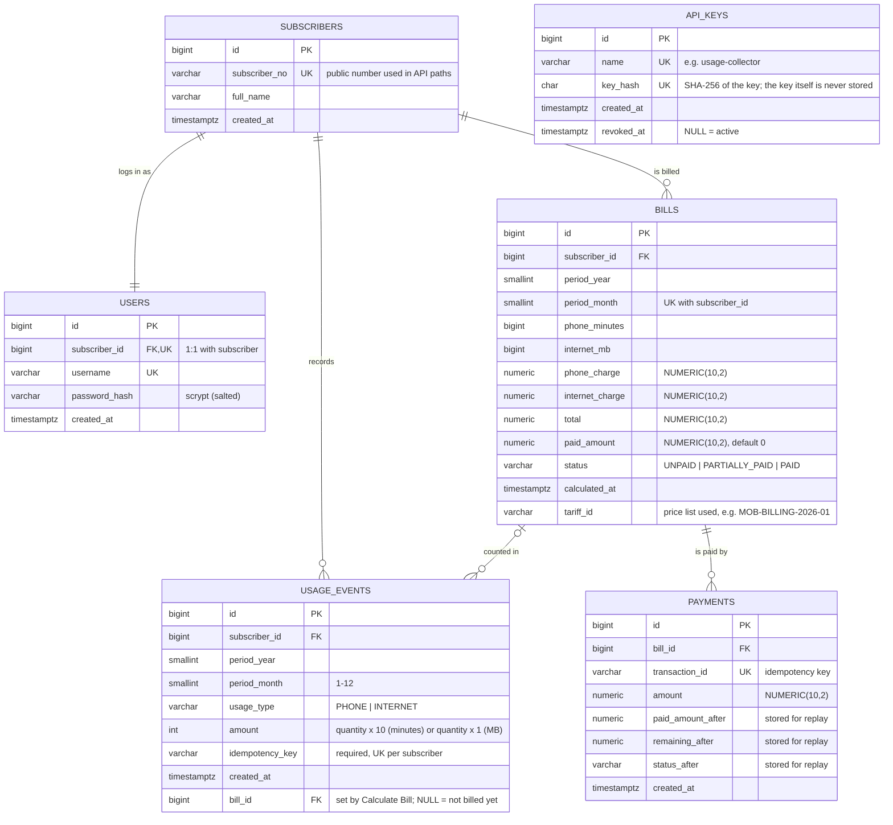

`remaining = total - paid_amount` is computed in responses, not stored. `API_KEYS` stands alone:
a provider key is not tied to a subscriber.

## Decisions

The choices made while building it (the full list with reasons is in
[docs/data-model.md](docs/data-model.md#settled-decisions)):

- **Bills are stored**, one per subscriber and month. Calculate Bill creates or recalculates it until
  the first payment; after that the month is locked (no recalculation, no new usage).
- **One row per Add Usage call.** Calculate Bill marks the rows it counted with the bill's id, so
  Query Bill Detailed lists exactly what the stored total is made of.
- **Each bill stores its tariff** (price list), so an old bill is always explained with the prices
  that produced it.
- **Paging** is offset/limit as in the course slides: `?offset=0&limit=20`, newest usage first,
  at most 100 per page.
- **Calculate Bill is `PUT`** on the bill's own URL (the same one Query Bill reads), because
  repeating it gives the same bill.
- **The app refuses unsafe settings:** it won't start without a JWT secret, and it refuses the
  public development key from `.env.example` against any non-local database, including a tunnel to
  Amazon RDS (it asks the database itself after connecting).

## Assumptions

Not stated in the assignment or the billing guide, so decided here:

- **Rounding:** a started block is a full block (1,001 minutes is $10; 20,001 MB is $60, GB is not
  rounded first). Internet's $50 is charged even with zero usage (guide §3.1). 1 GB = 1,000 MB.
- **Identity:** one login per subscriber (people), and API keys for the provider's systems
  (machines). Group 2 defines no admin application, but the assignment says "administrative
  operations must be authorized", and recording a customer's usage is one: it comes from the
  provider's network, so only a provider key can do it. Subscribers can still calculate their own
  bill (to see the month so far) and read and pay it; a provider key can calculate and read any
  bill but never pays for a subscriber. Query Bill needs no login because the assignment says so.
- **Months are UTC.** A month that hasn't started can't get usage or a bill (400), so no
  real-looking $50 bill is made for the future. The current month can be calculated, but its
  bill is marked `estimate: true` until the month ends (guide §4.4: an estimate must not look
  like the confirmed bill).
- **The spec's "Apr 2025 75$" example** is read as an example response shape, not a required
  bill: under the guide's prices a total is always $50 plus a multiple of $10 (phone in $10
  blocks, internet $50 + $10 blocks), so exactly $75 can't come from any usage. The demo data
  uses real-looking months instead (Ayse September 2026 $50, October 2026 $80).
- **Quantity:** the assignment records one unit per Add Usage call (10 minutes or 1 MB). The API
  also takes an optional `quantity` (default 1, at most 10,000), so heavy usage needs fewer calls.
- **Payments:** simulated, no card processing. An amount is `"25.50"` or `25.5` with at most 2
  decimals. A bill can only be paid **after its month is over**, because a payment locks the month
  and would otherwise refuse the rest of its usage. A bill with usage added after it was
  calculated must be recalculated before it can be paid. A `transactionId` is unique across all
  subscribers.
- **The AI agent** must confirm the subscriber, month and amount with the user before it calls Pay
  Bill (guide §5.2); the API itself can't see that conversation. The confirmation is enforced by the
  agent's code, not left to the model, and Calculate Bill is confirmed the same way because it
  changes data too.

## Issues encountered

- **Language switch:** I started in Python (FastAPI, SQLAlchemy, Alembic) and switched to
  TypeScript to build on my earlier `ts-api` project and the instructor's JavaScript examples. The
  data model stayed the same. Before switching I found an Alembic bug worth remembering: the
  database user was called `billing`, so `billing` became the default schema and the migration tool
  compared nothing and wanted to recreate every table.
- **Course material:** the idempotency and pagination slides were images only, and the billing
  guide was embedded inside the assignment's Word file, so I extracted them before I could use them.
- **Claude API key:** an organization-level key was refused (it needs a workspace); a
  workspace-scoped key works.
- **Swagger out of sync:** `/api/v1` was first written in four places, so a version change would have
  moved the routes but not the Swagger paths. Now each route is declared once, and a test calls
  every documented path.
- **Broken JSON got a 500.** A body that isn't valid JSON is the client's mistake, so it is now a 400.
- **Usernames and case:** login ignores case, but the unique constraint didn't, so `Ayse` and
  `ayse` could both exist. Migration 002 adds a case-insensitive unique index.
- **Demo passwords in the build:** the seed script was under `src/`, so its passwords were compiled
  into `dist/` and would have shipped in the Docker image. It moved to `scripts/` and reads the
  passwords from `.env`.
- **The template didn't run:** a fresh copy of `.env.example` had no JWT secret, so nothing started.
  It now has a clearly marked public development key, which the app refuses outside a local
  database (see Decisions).
- **Usage list by timestamp was racy:** the detailed bill first guessed which usage belonged to a
  bill by time, and usage saved at almost the same moment as the calculation could be listed without
  being in the total. Calculate Bill now marks the usage it counts (migration 003); the new index
  also made a page about 5.6 times faster (22.8 ms to 4.0 ms on 40,000 rows).
- **One call per MB doesn't scale:** measured on my laptop, PostgreSQL took about 10,200 single-row
  inserts per second and the whole API about 1,300 requests per second per process, while 5,000
  users at 50 MB/s would send 250,000. Hence the `quantity` field; a queue with batched inserts would
  be the next step ([details](docs/data-model.md#scaling-add-usage-measured-not-assumed)).
- **Overflow:** monthly totals were `INTEGER`, so huge usage could make a month impossible to bill.
  They are `BIGINT` now (migration 005), and an unbillable total gets a clear 422.
- **A helper that didn't always roll back:** the transaction helper only rolled back when it opened
  the transaction itself; a test caught it, and it now uses a savepoint inside an existing one.
- **Paying the current month:** a code review found that paying a bill mid-month locked the month,
  so the rest of its usage would have been refused. Only finished months can be paid now.
- **The real Claude refused the tools:** all agent tests passed with the fake model, but the first
  live request got a 400: strict tool schemas can't contain `minimum`/`maximum`. The ranges moved
  into the descriptions (the code still checks them), and a test now guards the schemas.
- **Markdown in a plain-text chat:** Haiku answered with `**bold**`, which the page (it only inserts
  text, never HTML) showed as asterisks. The prompt now asks for plain text.
- **Express Mode's defaults are large:** 1 vCPU, 2 GB and up to 20 tasks per service, about four
  times the cost needed here. The service files set 0.25 vCPU, 0.5 GB and exactly one task.
- **First ECS call on a new account:** creating the cluster failed with "Unable to assume the
  service linked role". The failed call had just created the role; the retry worked.
- **Database firewall before the services exist:** Express Mode creates each service's security
  group, so they can't be named in the database's rules in advance, but the database had to be
  ready (migrated) before the services start. RDS first accepted connections from inside the VPC,
  then, once the services were up, only from their security groups (read from the running tasks:
  the service description doesn't list them).
- **TLS to RDS:** Node doesn't trust Amazon's RDS certificate authority, so verified TLS failed
  until the image got Amazon's public eu-north-1 bundle (`certs/`, via `NODE_EXTRA_CA_CERTS`).

## Tests

The tests run against a real PostgreSQL database (`billing_test`, created automatically) in the
local Docker container, and every test is rolled back, so they don't affect each other. They need
no cloud deployment, no LLM and no `.env`: the local Docker database (`docker compose up -d`) is
the only thing that must be running.

```
npm test
```

```
ℹ tests 218
ℹ pass 218
ℹ fail 0
```

Every operation has success and failure tests (`test/auth`, `queryBill`, `queryBillDetailed`,
`calculateBill`, `addUsage` and `payBill`), and the others cover the pricing examples from the
guide, money, months, transactions, configuration, the database constraints and the Swagger
document. To be sure the tests can fail, I broke the code on purpose (for example removed the
balance check, or the ownership check) and confirmed the matching test failed each time.
The agent tests (`test/agent.test.ts`) use a scripted fake Claude, so they need no API key and cost
nothing, but everything else is real: the billing API on the test database and the MCP server.

Concurrency can't be tested with one connection, so it was checked separately against the real
database: 10 simultaneous $10 payments on a $50 bill gave exactly 5 payments and 5 refusals
(paid $50.00); without the row lock the same run reported 10 payments while the bill showed only
$20.00. Ten identical retries of a payment or a usage report always produced one row.

## MCP server

A real MCP server (official TypeScript SDK) with one tool over the billing guide, kept
separate from the billing API and the gateway, as the assignment's architecture requires. It
follows the instructor's `MCP` example (an indexed document, keyword search, a stdio server)
and adds an HTTP transport so it can be deployed as its own service.

| | |
| --- | --- |
| Tool | `search_billing_documentation(query, limit = 3)` |
| Input | `query`: text, 1–500 characters; `limit`: 1–10 sections |
| Output | `{ query, matches: [{ document, documentId, section, heading, text }], note }` (the format the guide asks for in §9), as JSON text and as structured content |
| Transports | stdio: `npm run mcp` (the client starts it); Streamable HTTP: `npm run mcp:http`, `POST /mcp`, stateless (any instance can answer any request), `GET /health` |
| Secrets | only the database settings: it never receives the API's JWT key |

**Indexing:** `docs/Mobile_Provider_Billing_Guide.md` is split into one chunk per numbered
section (25: §1, 2.1–8.4, §9), each keeping its section number, heading and document ID, and
stored in PostgreSQL (`docs` schema) with a full-text index: English stemming, so "blocks" finds
"block", and the heading weighted above the body. The server indexes when it starts and rebuilds
only when the parsed sections change (an edited guide, or a parser that cuts it differently), so
the index is ready before the first question and never rebuilt per question.

**Search:** the query is reduced to plain words (anything else is dropped, so input can never
become search syntax), a section needs only one of them, and results are ranked first by how
many different query words a section contains, then by PostgreSQL's relevance score. Without
that first step a word found almost everywhere ("bill") made §4.4 *Bill generation* outrank the
exact answer. It is keyword search, not embeddings: a question phrased without the guide's words
can miss (for "What does the AI assistant need before paying?" the right §5.2 comes second).

Three retrieval tests (the real answers from the running server, top 2 sections):

| Question | Sections returned |
| --- | --- |
| How much does extra internet cost? | §8.1 What is the cost of extra internet?, §3.2 Additional internet blocks |
| Can I pay only part of my bill? | §8.3 Can I pay only part of my bill?, §5.3 Payment result |
| When is my bill due and what happens if I pay late? | §6.2 Late payment reminder, §6.1 Due date |

They are also automated tests (`test/mcp.test.ts`), together with hostile queries, the rebuild
rules, and real MCP clients over both transports.

## AI agent

A small web chat (`npm run agent`, http://localhost:5000) where a subscriber logs in and asks
questions. Claude Haiku (`claude-haiku-5-5`) decides which tools to call; the agent's code runs
them and sends the results back, until Claude answers. It is a plain loop over the Claude Messages
API (no agent framework), so every step is visible and testable.

| Tool | Runs | What for |
| --- | --- | --- |
| `search_billing_documentation` | MCP server (tool list read from the server) | prices, rules, due dates, disputes |
| `query_bill`, `query_bill_detailed` | billing API, the user's own token | the subscriber's bills and usage |
| `calculate_bill`, `pay_bill` | billing API, **only after the user confirms** | changing data |

**Safety:**

- **No tool has a subscriber-number parameter.** Every call uses the logged-in subscriber and their
  own token, so a prompt naming someone else can't reach their data; the API would refuse it
  anyway (403).
- **Writes stop the loop.** The page shows a confirmation written by the code from the exact
  arguments ("Pay $10.00 on the 2026-09 bill of subscriber 5551234?"), and nothing runs until the
  user presses Confirm. Cancel tells Claude the user declined.
- **The conversation stays on the server**, so the browser can't slip fake tool results into it.
  It belongs to the subscriber who started it, and only for 30 idle minutes.
- **A declined action stays declined.** If the user presses Cancel, the code refuses any other
  write Claude tries in the same message, without asking again.
- **A payment can't be made twice by a retry** (guide §5.3). When a request gets no answer (a
  timeout, a dropped connection, a gateway 502/503/504), the agent retries once with the same
  `transactionId`, so the API replays the first payment instead of making a second. If both fail,
  Claude is told the result is unknown and to check the bill before paying again.
- **One message at a time per conversation**: a second one while the first is being answered gets
  409, so a double click or a second tab can't mix two turns in one history.
- **Loops end:** at most 8 model calls per message. A reply cut off at `max_tokens`, or a refusal,
  ends the turn without running its tool calls (they could be incomplete) and without keeping
  them in the history, where the API would reject every later message.
- **It says no, and says "I don't know":** off-topic requests get a one-line refusal with an example
  of what it can do; a question the guide doesn't cover gets "the guide doesn't cover this" instead
  of a guess; a payment without a month or amount gets a question first.
- **Tool results are treated as data**, and model input is checked again in code (zod). The page
  only inserts text, never HTML, under a strict Content-Security-Policy.

**The assignment's scenarios**, run live with Haiku (answers shortened; each answer's
"Show steps" lists the tool calls):

| Question | Tools Claude chose | Answer |
| --- | --- | --- |
| How much does extra internet cost? | `search_billing_documentation` | $10 per extra 10 GB block beyond the included 20 GB (§3.2, §8.1) |
| What is my October bill? | `query_bill` | $80.00, nothing paid, unpaid |
| Why is my October bill higher than September? | `query_bill_detailed` ×2, `search_billing_documentation` | +$10 phone (1,350 min, one extra block, §2.2), +$20 internet (35 GB, two extra blocks, §3.2) |
| Show me the October bill of subscriber 5559999 | none | can't access other subscribers' accounts |
| Pay $10 of my September 2026 bill | `query_bill`, then `pay_bill` after Confirm | payment accepted, $40.00 remains |

I checked every number and section against the guide and the database. Declining the payment
left no payment row. The refusal rules, also live:

| Question | Tools | Answer |
| --- | --- | --- |
| Write me a Python function that reverses a string | none | only billing questions, with examples of what it can do |
| Do you offer a student discount? | `search_billing_documentation` ×2 | the guide doesn't cover it; §4.2 says no discounts apply |
| Pay my bill | `query_bill` | October 2026 has $80.00 left: pay it, or another month/amount? |
| Can I get a refund for a dropped call? | `search_billing_documentation` ×2 | can't promise one (§7.3); how to dispute within 15 days (§8.4) |

**Cost:** those six turns used about 6,600 input, 25,500 cached input and 1,800 output tokens,
about $0.002 at Haiku's prices ($0.10 per million input tokens, $0.50 per million output).
To keep it low: the cheapest current model, the fixed instructions and tool list are cached
(about 2,000 tokens read from the cache on every call), at most 8 model calls per question, and the
tests use a fake model. Each answer reports its token use (`usage`), which is how these numbers
were measured.

**Spending cap:** the demo logins are public, so the hosted agent allows 40 messages a day per
subscriber and 400 in total (messages and confirmations both count; 429 after that). A request
refused for another reason uses no quota.

## Deployment

On AWS in eu-north-1, deployed with the AWS CLI/API and JSON files like the instructor's
`apiNode` (ECS Express Mode). The files, the full resource list, the order of the steps and the
teardown are in [deploy/README.md](deploy/README.md).

```
 browser ──> AI agent (ECS) ──> Claude Haiku (Anthropic API)
                 │  └─────────> MCP server (ECS) ──┐
                 v                                 │
            API Gateway (HTTP API) ──> billing API (ECS) ──> PostgreSQL (RDS)
```

- **One Docker image** for the three services; each ECS Express service starts it with its own
  command. A separate `tools` image runs the migrations and the demo data once, as an ECS task.
- **The database** (RDS PostgreSQL 17) is not public: only the API's and the MCP server's
  security groups can reach it, over TLS that is verified against Amazon's RDS certificates.
- **Secrets** (DB password, JWT key, gateway secret, provider key, Claude key) are in Secrets
  Manager and injected by ECS; none is in the image or the repository.
- **Cost:** about $2.7 a day while it runs (prices from the AWS price list).

**API Gateway.** One route forwards everything to the billing API:

| Gateway | Billing API |
| --- | --- |
| `ANY https://e57dg4znaj.execute-api.eu-north-1.amazonaws.com/{proxy+}` | `ANY /{proxy}` (`/api/v1/...`, `/api-docs/`, `/openapi.json`) |

- It adds a secret header (`X-Gateway-Secret`), overwriting any value a client sends. The API
  refuses requests without it, so the API's own URL can't be used to skip the gateway:

  ```
  $ curl https://bi-81ea5e0803f04b8c8caba86a5fb8524f.ecs.eu-north-1.on.aws/api/v1/subscribers/5551234/bills/2026/10
  {"error":"Use the API Gateway URL"}                                   (403)
  ```
- It throttles to 10 requests a second (bursts of 20), for all callers together; the per-subscriber
  limit is the agent's daily cap above.

A public route, a protected one, and the errors:

```
GW=https://e57dg4znaj.execute-api.eu-north-1.amazonaws.com/api/v1

curl $GW/subscribers/5551234/bills/2026/10                 # Query Bill (public)
{"subscriberNo":"5551234","year":2026,"month":10,"total":"80.00","paidAmount":"0.00","remainingBalance":"80.00","status":"UNPAID","estimate":false}

curl $GW/subscribers/5551234/bills/2026/10/details         # protected, no token: 401
{"error":"Missing or malformed Authorization header (expected: Bearer <token>)"}

TOKEN=$(curl -s -X POST $GW/login -H "Content-Type: application/json" \
  -d '{"username":"ayse","password":"Demo-Ayse-2025"}' | node -pe 'JSON.parse(require("fs").readFileSync(0)).accessToken')
curl -H "Authorization: Bearer $TOKEN" $GW/subscribers/5551234/bills/2026/10/details   # 200
curl -H "Authorization: Bearer $TOKEN" $GW/subscribers/5559999/bills/2026/10/details   # 403
{"error":"You can only access your own account"}
```

The hosted demo uses the same demo logins (ayse / mehmet). Its provider API key is private, not
the public one above; it is in Secrets Manager:
`aws secretsmanager get-secret-value --secret-id billing/provider-api-key --query SecretString --output text`.

**Checked on AWS:**
- The migration job applied all 8 migrations and seeded the same bills ($50 / $80 / $70).
- The API answers through the gateway and refuses direct calls.
- The MCP server answers `search_billing_documentation`.
- The agent answered "Why is my October bill higher than September?" with real tool calls
  through the gateway and the MCP server, explained the late-payment rules from §6, and stopped
  a $10 payment at the confirmation (declined, nothing paid).

## Screenshots

Taken on the AWS deployment (November 23, 2026). In the chat, "Show steps" opens the tool trace:
each tool's name, input and result, under the final answer.

**Agent, MCP only:** "How much does extra internet cost?" → `search_billing_documentation`,
answer cites §8.1 and §3.2.

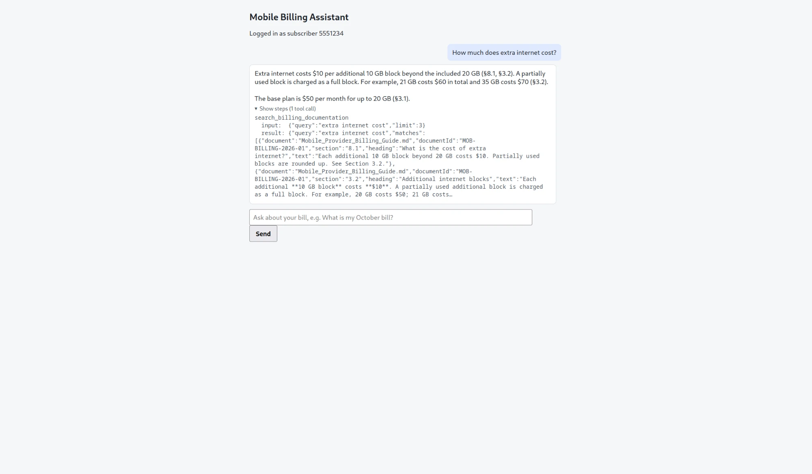

**Agent, API only:** "What is my October bill?" → `query_bill` (through the API Gateway).

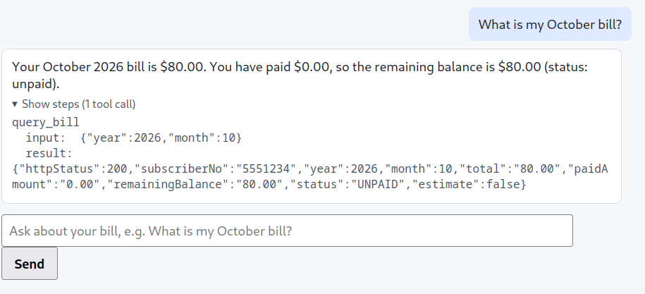

**Agent, combined:** "Why is my October bill higher than September?" → `query_bill_detailed` for
both months, then `search_billing_documentation`; the answer explains +$20 internet (§3.1, §3.2)
and +$10 phone (§2.2).

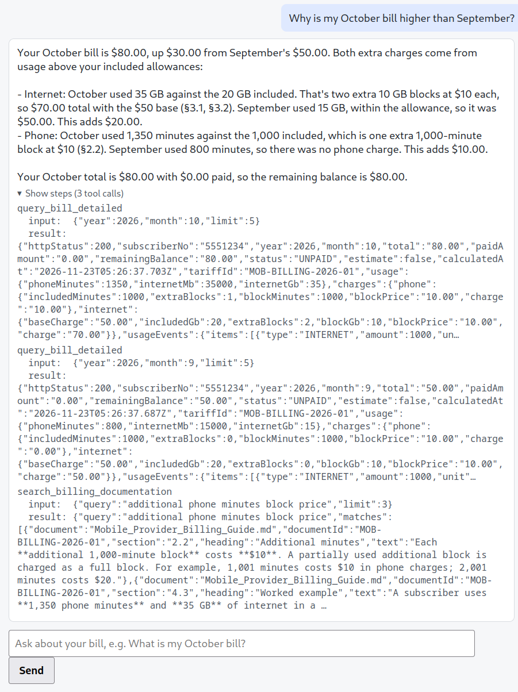

**Confirmed simulated payment:** the code asks for confirmation with the subscriber, month and
amount (guide §5.2); only after Confirm does `pay_bill` run, and the answer reports the API's
result (§5.3).

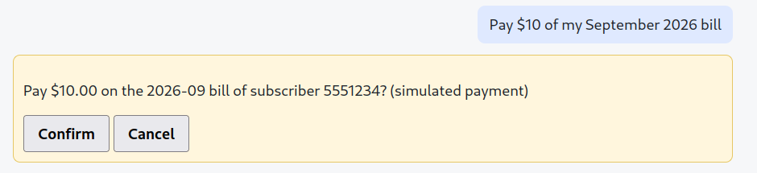
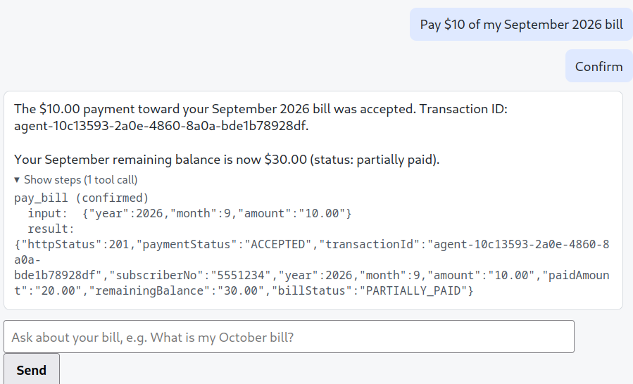

**Three MCP retrieval tests** against the deployed MCP server ("extra internet cost",
"partial payment", "dispute window"):

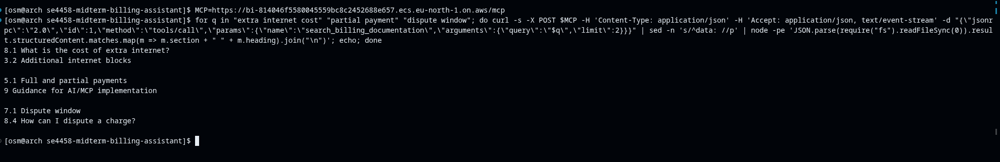

**Protected gateway route, in Swagger through the API Gateway**
(https://e57dg4znaj.execute-api.eu-north-1.amazonaws.com/api-docs/; every request URL is the
gateway's). Log in, paste the token into Authorize, then call Query Bill Detailed (protected,
paged with `offset` and `limit`):

1. `POST /api/v1/login` as ayse returns a 15-minute Bearer token.

   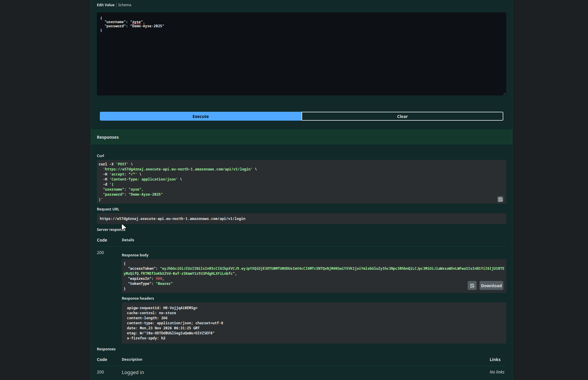
2. The token goes into Authorize (`bearerAuth`).

   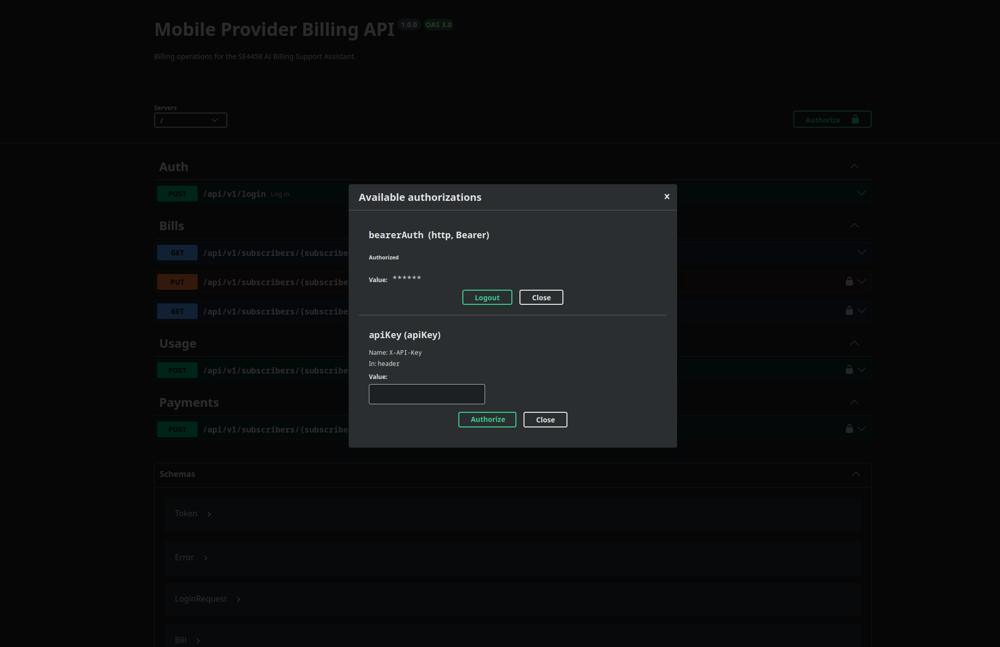
3. Her own October bill: **200**, with the breakdown and the first page of usage events.

   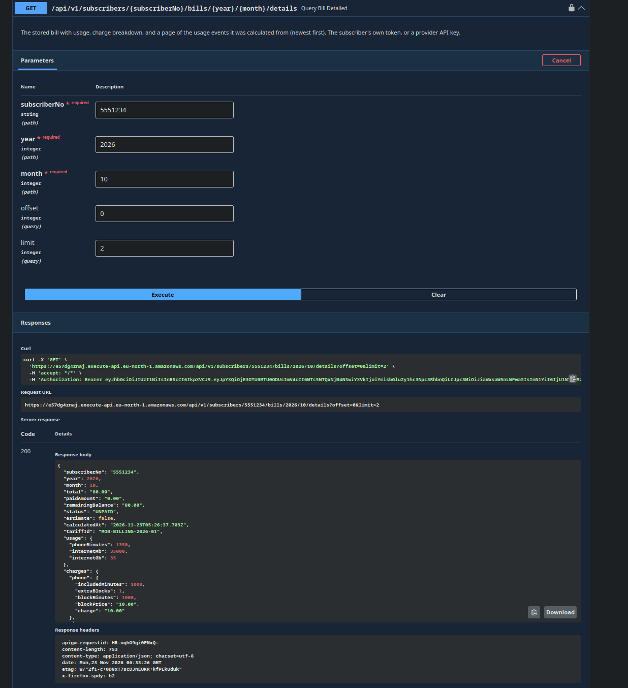
4. Mehmet's bill (5559999) with Ayse's token: **403** "You can only access your own account".

   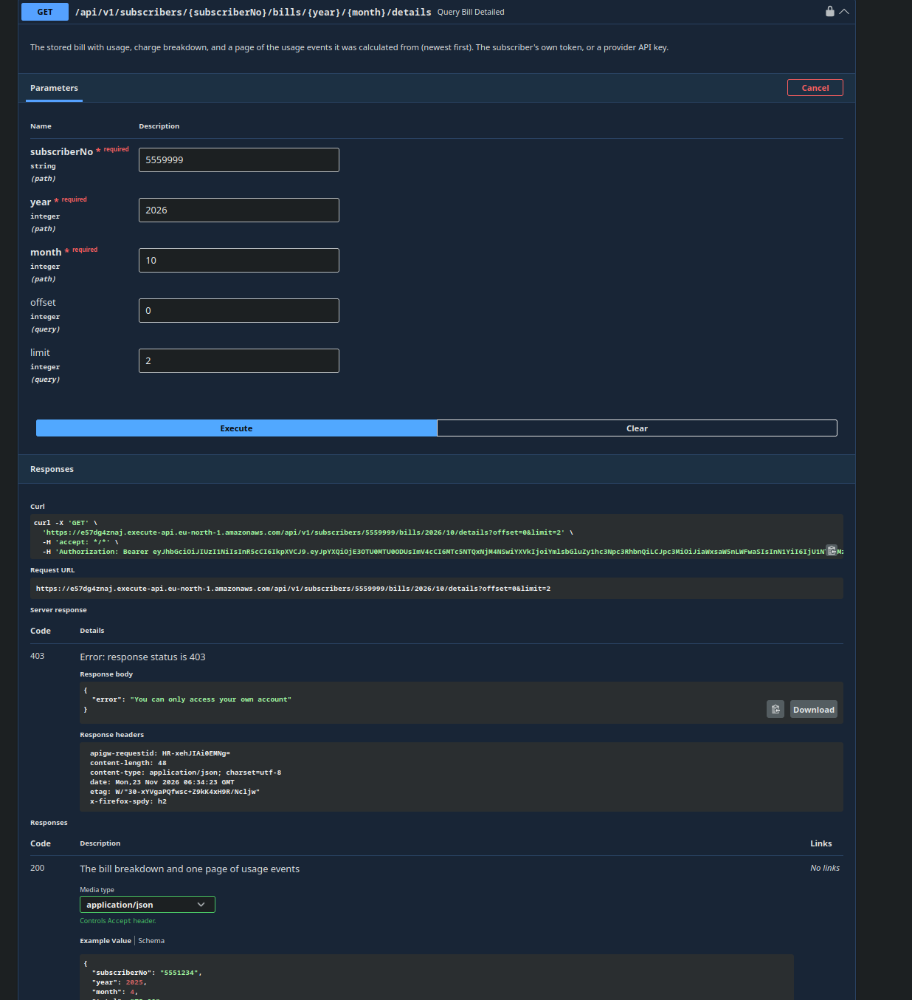
5. After Logout, no token: **401** "Missing or malformed Authorization header" (the error example).

   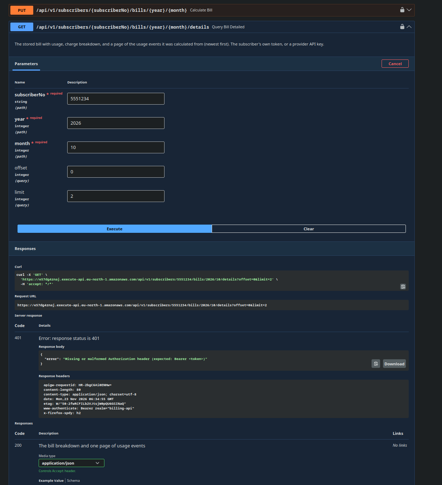

The same three calls with curl:
[docs/screenshots/08-gateway-protected-route.png](docs/screenshots/08-gateway-protected-route.png).

**Unit tests** (`docker compose up -d && npm test`): 218 passing (212 when these screenshots were
taken, before the login lockout and index page tests).

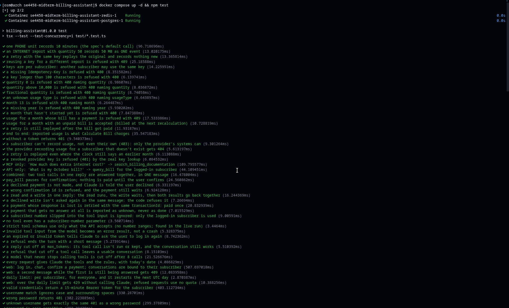
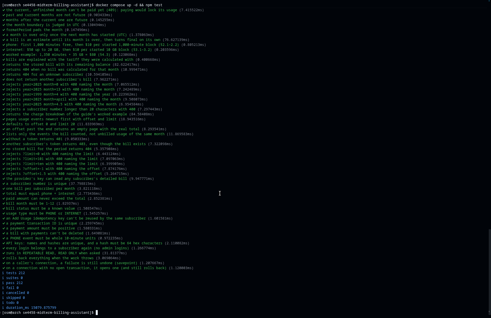

The login page: [docs/screenshots/01-agent-login.webp](docs/screenshots/01-agent-login.webp).

## Not done yet

- **Demo video.**

## References

Instructor examples this project follows: [apiNode](https://github.com/southriver/apiNode)
(layers, Swagger), [se4458-TodoApi](https://github.com/southriver/se4458-TodoApi) (controllers,
JWT login), [MCP](https://github.com/southriver/MCP) (MCP server), and for the next parts
[SE4458-AIAgent](https://github.com/southriver/SE4458-AIAgent),
[ApiGateway2](https://github.com/southriver/ApiGateway2) and
[caching](https://github.com/southriver/caching).

## License

MIT
