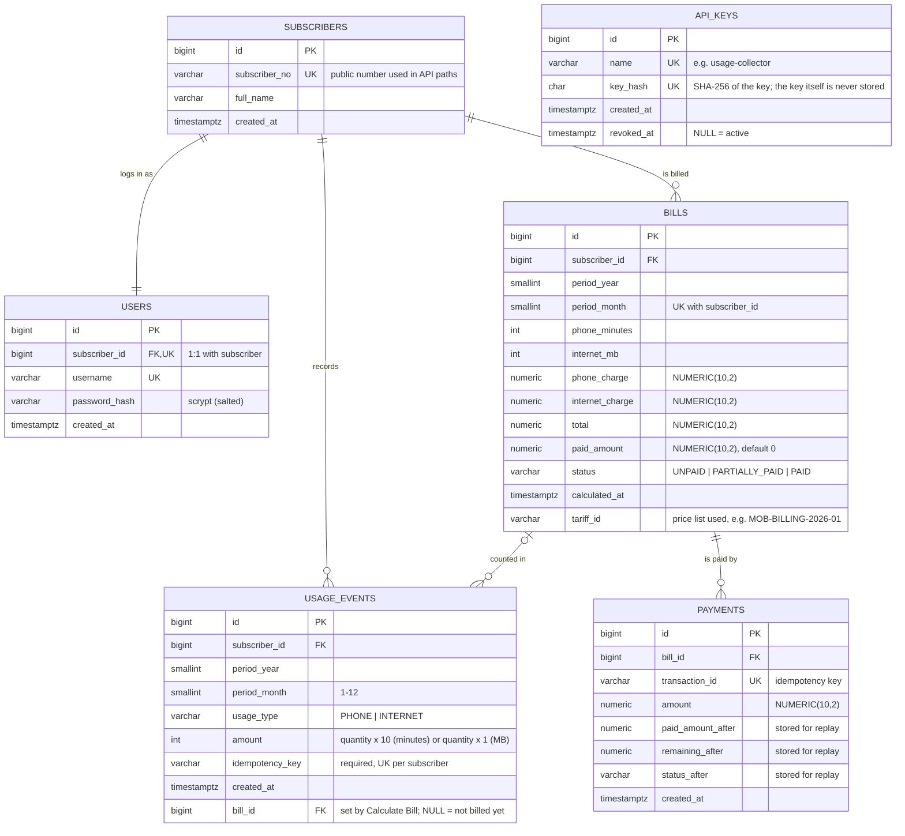

# Data model

Status: decisions marked ✅ are settled; rows marked *assumption* in the business rules are
mine (not stated in the assignment or the guide) and are listed in the README.

Two separate stores in one PostgreSQL server (Docker locally; Amazon RDS in eu-north-1 once deployed):

- schema `billing` — live records used by the REST APIs
- schema `docs` — the indexed billing guide, used only by the MCP server

## ER diagram — `billing` schema

`remaining = total - paid_amount` is computed in responses, not stored on the bill.

## `docs` schema (MCP index, separate from billing, migration 008)

| Table | Column | Notes |
| --- | --- | --- |
| documents | id, document_id (UK) | `MOB-BILLING-2026-01` |
| | file_name, title, version | `Mobile_Provider_Billing_Guide.md`, `Mobile Provider Billing Guide`, `1.0` |
| | source_hash | SHA-256 of the parsed sections: unchanged = no rebuild |
| chunks | id, document_id (FK), ordinal | one row per numbered section, in document order |
| | section, heading, text | e.g. `3.2`, `Additional internet blocks`, the section's text |
| | search_vector | generated by the database: heading (weight A) + text (weight B), English stemming; GIN index |

One chunk per numbered section (25 for this guide: §1, 2.1–8.4, §9). The MCP server indexes
the committed copy in `docs/` when it starts, and rebuilds only when the parsed sections
change (the guide, or how it is cut), never per question. Search ranks sections by how many different query words they
contain, then by `ts_rank_cd`; results use the output format the guide asks for in §9.

## Settled decisions

| # | Decision | Why |
| --- | --- | --- |
| ✅ 1 | Bills are stored; Calculate Bill upserts the one bill per (subscriber, year, month) | Same usage → same bill, so recalculating is idempotent |
| ✅ 2 | A bill can be recalculated until its first payment; after that it is locked | Keeps a paid balance from shifting under the customer |
| ✅ 3 | One `usage_events` row per Add Usage call | Gives Query Bill Detailed real rows to page through |
| ✅ 4 | Add Usage requires an `Idempotency-Key` header; a repeat returns the first result and adds nothing | Add Usage is an "increment", which the class notes say is not idempotent on its own |
| ✅ 5 | Pay Bill treats `transactionId` as its idempotency key; a repeat with the same details replays the original result, a repeat with different details → 409 | No double charge on retries (class slide 31) |
| ✅ 6 | Pay Bill locks the bill row (`SELECT … FOR UPDATE`) in one transaction | Two concurrent payments can't both pass the balance check (concurrency slide 32) |
| ✅ 7 | Subscribers log in (own `users` table + JWT, token `sub` = subscriber_no); the provider's systems use API keys (`api_keys`, `X-API-Key`, only a SHA-256 hash stored, revocable) | People get accounts, machines get keys; the agent only ever works as the logged-in subscriber (migration 007) |
| ✅ 8 | Money as `NUMERIC(10,2)`; integer cents in TypeScript, `"75.00"` strings in JSON | Exact amounts, no float rounding |
| ✅ 9 | Calculate Bill links the usage events it sums (`usage_events.bill_id`), in the same transaction | Query Bill Detailed lists exactly what the stored total counted; a timestamp filter was racy (migration 003) |
| ✅ 10 | Each bill stores its `tariff_id` | An old bill is explained with the prices that produced it, even after a price change (migration 004) |

## Billing formulas (assignment + Mobile_Provider_Billing_Guide.md §2–4)

- Phone (§2.1–2.2, §4.2): first 1,000 minutes free, then $10 per *started* 1,000-minute block
  → `10 × ceil(max(0, minutes − 1000) / 1000)`
- Internet (§3.1–3.3, §4.2): **$50 every month** for up to 20 GB — *including months with zero
  usage* (§3.1) — then $10 per *started* additional 10 GB block; 1 GB = 1,000 MB
  → `50 + 10 × ceil(max(0, mb − 20000) / 10000)`
  (same as the guide's GB formula with `GB = mb / 1000`; GB is **not** rounded first, so
  20,001 MB → $60, because a partially used block is a full block, §3.2)
- Total = phone + internet; no taxes, fees or discounts (§4.2)
- Checked against every example in the guide: 1,001 min → $10, 2,001 min → $20, 0 MB → $50,
  20 GB → $50, 21 GB → $60, 30 GB → $60, 35 GB → $70, worked example 1,350 min + 35 GB → $80 (§4.3)
- Implement with integer ceiling division (`-(-a // b)`), not floats.

## Other facts from the billing guide that touch the data

- Due date = 15 calendar days after the end of the billing month (§6.1) — computed from
  `period_year`/`period_month`, not stored.
- Disputes are allowed within 15 days of the bill *issue date* (§7.1) — `calculated_at` is the issue date.
- Late reminders, service restriction and disputes are policy text only (§6.2–7.3); no tables or APIs.

## Business rules resolved from the documents

Sources: assignment = `SE4458_Midterm_202627_01.md`, guide = `Mobile_Provider_Billing_Guide.md`.
Rows marked *assumption* are not stated in either document and go into the README's assumptions list.

| # | Rule | Source |
| --- | --- | --- |
| 1 | Internet $50 is charged every month, even with zero usage | guide §3.1 |
| 2 | Pay Bill never takes more than the remaining balance: an amount above it, or any payment on a fully paid bill, gets 422. A malformed or non-positive amount is invalid input (400), like every other endpoint | assignment line 87 "preserve balance"; Group 1 line 38 ("reject … amounts exceeding balance") |
| 3 | Access: Add Usage needs a provider API key; Calculate Bill and Query Bill Detailed accept the own subscriber's token or a provider key; Pay Bill only the own subscriber's token; Query Bill needs nothing; both a key and a token in one request → 400 | assignment table (all "Authentication: YES" except Query Bill); line 113 "administrative operations must be authorized" and "never … access another user's private data". *Assumption:* usage comes from the provider's network, so only the provider's systems record it; Group 2 defines no admin application |
| 4 | Add Usage for a period whose bill is locked (has a payment) → 409 | *assumption* — follows from settled decision 2 (bills lock after first payment); prevents unbilled usage |
| 5 | Pay Bill for a period with no stored bill → 404 "calculate the bill first" | guide §4.4: bills are produced by Calculate Bill and an estimate must not be treated as a stored bill |
| 6 | Bill status: `UNPAID` (paid = 0), `PARTIALLY_PAID` (0 < paid < total), `PAID` (paid = total) | guide §5.1 "a partial payment … does not mark the bill fully paid" |
| 7 | Calculate Bill is `PUT` on the bill (idempotent upsert): 201 when created, 200 when recalculated, 409 once the bill has a payment | settled decisions 1–2; course idempotency slides (PUT is idempotent) |
| 8 | Calculate Bill refuses months that haven't started yet (400); the current month is allowed and can be recalculated until paid | *assumption* — otherwise a future month gets a real-looking $50 bill (guide §3.1 charges the base with zero usage) |
| 9 | Billing months are judged in UTC | *assumption* — the documents name no time zone |
| 10 | Recalculating with no new usage leaves the bill unchanged, including its issue date (`calculated_at`) | guide §7.1: the issue date starts the 15-day dispute window, so a no-op must not move it |
| 11 | Add Usage is `POST /subscribers/{no}/usage` with `{year, month, usageType, quantity?}`; one call = one `usage_events` row of `quantity` units (10 min or 1 MB each) | spec + guide §2.3, §3.3 define one unit per call; *extension:* optional `quantity` (default 1, max 10,000) so heavy usage needs far fewer calls (see Scaling) |
| 12 | Same `Idempotency-Key` + same body → the original 201 response again, with header `Idempotent-Replayed: true`, nothing recorded; same key + different body → 409; keys are unique per subscriber | settled decision 4; 409 mirrors Pay Bill's rule (decision 5) |
| 13 | A retry is replayed even if the month's bill was paid after the original call | a retry must get the original answer; the lock (rule 4) applies only to new usage |
| 14 | Add Usage refuses months that haven't started yet (400) | *assumption* — same reason as rule 8 |
| 15 | Usage added after a bill was calculated stays unbilled until the bill is recalculated; Pay Bill refuses to pay such a bill (409, rule 17) | follows from decision 9 |
| 16 | Pay Bill is `POST /subscribers/{no}/bills/{year}/{month}/payments` with `{transactionId, amount}`; amount as `"25.50"` or `25.5`, at most 2 decimals; 201 with payment status, paid amount, remaining balance and bill status | assignment Pay Bill row; a payment is a new resource of that bill |
| 17 | A bill with unbilled usage can't be paid: 409 "recalculate first" | *assumption (my decision, to review)* — paying locks the month (decision 2), so that usage would otherwise never be billed |
| 18 | Only finished months can be paid (the current month gets 409) | *assumption (my decision, to review)* — paying locks the month, so paying mid-month would refuse the rest of its usage; guide §6.1 makes a bill due after its month ends |
| 19 | A retried `transactionId` (same subscriber, month and amount) replays the original result with `Idempotent-Replayed: true`, even after later payments; anything else with that ID → 409. IDs are unique across all subscribers | settled decision 5; assignment "reject duplicate transaction IDs" |
| 20 | Payments are simulated; the AI agent must get explicit confirmation of subscriber, month and amount before calling Pay Bill | assignment; guide §5.2 |
| 21 | Bill responses carry `estimate`: `true` while the month is still running (the total so far, which will change and can't be paid yet), computed from the month and the current UTC date, not stored | guide §4.4: an estimate must not be presented as the confirmed bill |

## Scaling (Add Usage): measured, not assumed

The spec records **1 MB per Add Usage call**. A subscriber using 50 MB/s would make 50 calls
per second; 5,000 such subscribers 250,000 calls/s (and ~650 billion rows a month).
Measured on the development laptop (22 cores, local Docker Postgres, no network):

| Path | Rate |
| --- | --- |
| Postgres, one row per transaction (20 connections) | ~10,200 rows/s |
| Postgres, one batched `INSERT` of 50,000 rows | ~91,800 rows/s |
| Full Add Usage (HTTP + JWT + validation + Postgres), one Node process, 50 in flight | ~1,330 requests/s |

What this project does: the optional `quantity` (rule 11) lets a caller report 50 MB in
one call, turning 250,000 calls/s into 5,000 calls/s, which several app processes (ECS
tasks) can serve within the database's measured capacity; the API Gateway adds
per-subscriber rate limits. What a real system would add next: an ingestion queue
(API → SQS → batch writer using multi-row inserts, answering 202 Accepted) and a
`usage_events` table partitioned by month. Real carriers aggregate usage per session or
interval in the network before billing ever sees it.

