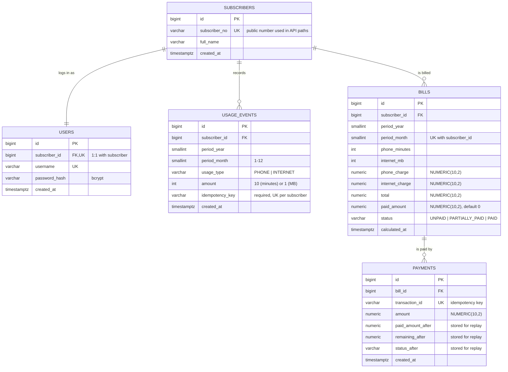

# Data model (draft)

Status: **draft** — decisions marked ✅ are settled; items under *Open questions* are not.

Two separate stores in one PostgreSQL server (RDS, eu-north-1):

- schema `billing` — live records used by the REST APIs
- schema `docs` — the indexed billing guide used only by the MCP server

Redis (ElastiCache) caches Query Bill responses; it holds no tables.

## ER diagram — `billing` schema

`remaining = total - paid_amount` is computed in responses, not stored on the bill.

## `docs` schema (MCP index, separate from billing)

| Column | Type | Notes |
| --- | --- | --- |
| id | bigint PK | |
| document | varchar | `Mobile_Provider_Billing_Guide.md` |
| document_id | varchar | `MOB-BILLING-2026-01` |
| section | varchar | e.g. `3.2` |
| heading | text | e.g. `Additional internet blocks` |
| text | text | chunk text returned as the excerpt |
| search_vector | tsvector | generated from heading + text; GIN index |

One row per numbered section (e.g. 2.1, 3.2, 8.4). Filled once by an indexing script; the
MCP server only reads it. Columns follow the output format the guide asks for in §9
(`document`, and matches with `section`, `heading`, `text`).

## Settled decisions

| # | Decision | Why |
| --- | --- | --- |
| ✅ 1 | Bills are stored; Calculate Bill upserts the one bill per (subscriber, year, month) | Same usage → same bill, so recalculating is idempotent |
| ✅ 2 | A bill can be recalculated until its first payment; after that it is locked | Keeps a paid balance from shifting under the customer |
| ✅ 3 | One `usage_events` row per Add Usage call | Gives Query Bill Detailed real rows to page through |
| ✅ 4 | Add Usage requires an `Idempotency-Key` header; a repeat returns the first result and adds nothing | Add Usage is an "increment", which the class notes say is not idempotent on its own |
| ✅ 5 | Pay Bill treats `transactionId` as its idempotency key; a repeat with the same details replays the original result, a repeat with different details → 409 | No double charge on retries (class slide 31) |
| ✅ 6 | Pay Bill locks the bill row (`SELECT … FOR UPDATE`) in one transaction | Two concurrent payments can't both pass the balance check (concurrency slide 32) |
| ✅ 7 | Own `users` table + JWT; token `sub` = subscriber_no | Agent can only reach the logged-in subscriber's data |
| ✅ 8 | Money as `NUMERIC(10,2)` → Python `Decimal` | Exact decimal amounts |

## Billing formulas (assignment + Mobile_Provider_Billing_Guide.md §2–4)

- Phone (§2.1–2.2, §4.2): first 1,000 minutes free, then $10 per *started* 1,000-minute block
  → `10 × ceil(max(0, minutes − 1000) / 1000)`
- Internet (§3.1–3.3, §4.2): **$50 every month** for up to 20 GB — *including months with zero
  usage* (§3.1) — then $10 per *started* additional 10 GB block; 1 GB = 1,000 MB
  → `50 + 10 × ceil(max(0, mb − 20000) / 10000)`
  (same as the guide's GB formula with `GB = mb / 1000`; GB is **not** rounded first, so
  20,001 MB → $60, because a partially used block is a full block, §3.2)
- Total = phone + internet; no taxes, fees or discounts (§4.2)
- Checked against every example in the guide: 1,001 min → $10, 2,001 min → $20, 0 MB → $50,
  20 GB → $50, 21 GB → $60, 30 GB → $60, 35 GB → $70, worked example 1,350 min + 35 GB → $80 (§4.3)
- Implement with integer ceiling division (`-(-a // b)`), not floats.

## Other facts from the billing guide that touch the data

- Due date = 15 calendar days after the end of the billing month (§6.1) — computed from
  `period_year`/`period_month`, not stored.
- Disputes are allowed within 15 days of the bill *issue date* (§7.1) — `calculated_at` is the issue date.
- Late reminders, service restriction and disputes are policy text only (§6.2–7.3); no tables or APIs.

## Business rules resolved from the documents

Sources: assignment = `SE4458_Midterm_202627_01.md`, guide = `Mobile_Provider_Billing_Guide.md`.
Rows marked *assumption* are not stated in either document and go into the README's assumptions list.

| # | Rule | Source |
| --- | --- | --- |
| 1 | Internet $50 is charged every month, even with zero usage | guide §3.1 |
| 2 | Pay Bill amount must be > 0 and ≤ remaining balance; otherwise 422 | assignment line 87 "preserve balance"; Group 1 line 38 states the same rule explicitly ("reject … amounts exceeding balance") |
| 3 | Add Usage and Calculate Bill require a valid JWT and act only on the token's own subscriber (no admin role) | assignment table: both "Authentication: YES"; line 113 "never … access another user's private data". *Assumption:* no separate admin role, since the assignment defines none |
| 4 | Add Usage for a period whose bill is locked (has a payment) → 409 | *assumption* — follows from settled decision 2 (bills lock after first payment); prevents unbilled usage |
| 5 | Pay Bill for a period with no stored bill → 404 "calculate the bill first" | guide §4.4: bills are produced by Calculate Bill and an estimate must not be treated as a stored bill |
| 6 | Bill status: `UNPAID` (paid = 0), `PARTIALLY_PAID` (0 < paid < total), `PAID` (paid = total) | guide §5.1 "a partial payment … does not mark the bill fully paid" |
